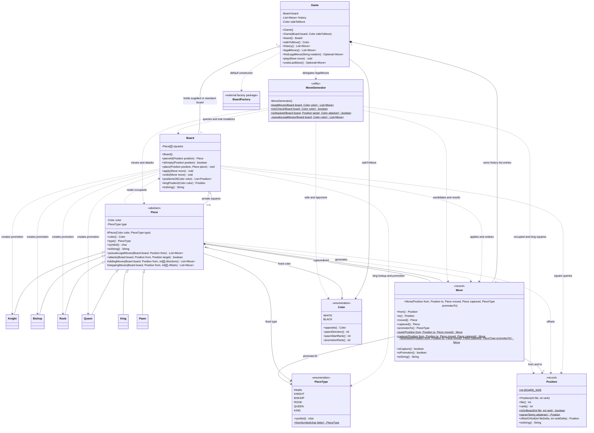
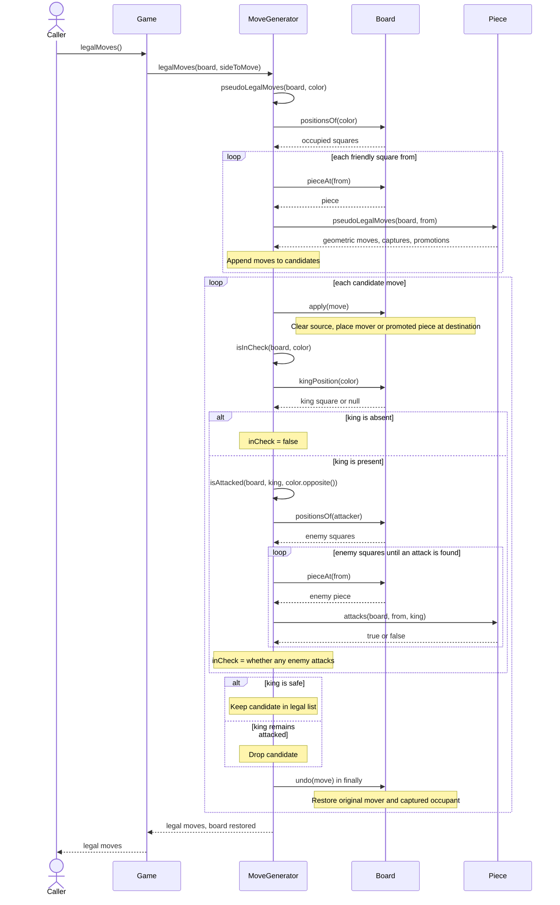

# Engine design after M5

These diagrams describe this repository's implementation at M5. `engine`
contains `Game` and the stateless `MoveGenerator`; `model` contains all the
remaining types below. There is currently no `BoardView` interface.

## Class diagram

All declared public methods are shown, including record accessors and canonical
constructors. Compiler-generated `equals`/`hashCode` and enum `values`/`valueOf`
are omitted. The six subclasses inherit the public `Piece` API; their common
`Color` constructors and move overrides are omitted as permitted by the handout.
`Pawn` additionally overrides `attacks`. Protected helpers are included to show
where the two shared movement algorithms live.

The hollow diamonds denote stored references: a supplied `Board` may also be
held by its caller, and pieces may be referenced by both the board and moves.
The filled diamond denotes `Game`'s internally created history collection;
`Move` values in it may also be held by callers. `history()` returns an immutable
snapshot. `MoveGenerator` stores no references between calls. An empty square,
a missing king, and the optional capture/promotion fields use `null`.

## Sequence: `game.legalMoves()`

The `Piece` lifeline represents each piece encountered. Helpers called within
`Piece` use `Board.pieceAt` and `Position.offsetOrNull`; those inner movement
loops are summarized by the `pseudoLegalMoves` response. `kingPosition` scans
the board's occupied squares of the requested color. Opponent attack checks
stop at the first attacker. The candidate board is always undone in `finally`.

